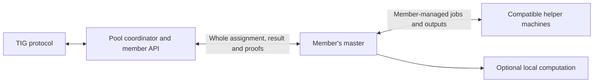
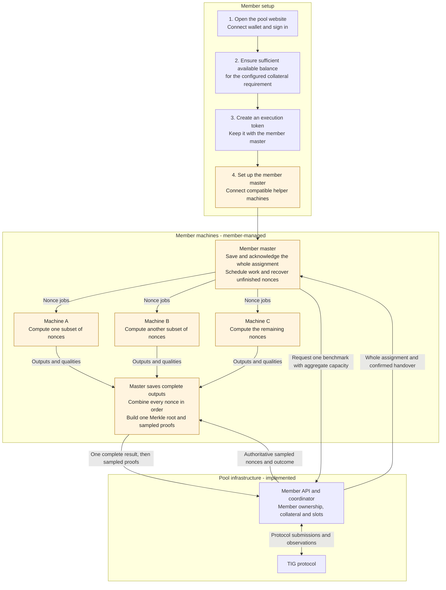

# Member master integration

Agreed 11 October 2026. The pool assigns one complete benchmark to one member.
The member's **master** is their pool-facing client. It may compute locally,
distribute different nonces to compatible helper machines, or combine both.
Members operate communication and scheduling within their own machines, using
their own client or the optional SSH mode in the reference worker. The pool
coordinates the complete benchmark with the master.
Shared execution across several machines is the expected member operating model;
the member-managed master is the entry point for that arrangement.

This uses [member API 2.0](MEMBER_API_V2.md). Ownership is bound to the
authenticated member, without a machine registration or machine ID. The
reference worker demonstrates the same assignment/result/proof contract. Its
optional SSH helper mode is described in
[the implementation and verification note](SSH_MEMBER_MASTER_VERIFICATION.md).

Start with the [member setup guide](MEMBER_SETUP_V2.md) for website registration,
the execution token, API connection settings and receiving your first assignment.



## Member onboarding and a shared benchmark

The pool-side scaffolding supports this model: authentication and benchmark
ownership identify the member, offers can describe aggregate compatible nonce
capacity, and the API accepts one combined result and the sampled proofs. Helper
machines add neither a collateral reservation nor an execution slot. One shared
benchmark uses one of the member's two slots.

The following diagram shows the member's setup steps and subsequent computation.
Orange nodes are member-supplied software and setup. The current Join-page
installer supplies the single-machine reference worker; it does not install a
distributed master, pair helpers or configure their communication. The helper
jobs and output collection shown here are the member's implementation of the
contract, not additional pool API routes. The reference worker also supplies an
optional SSH helper mode; its default website installer remains single-machine.



Only the master uses the member execution token to talk to the pool. Each helper
executes the same immutable benchmark assignment with a different nonce subset;
the master must collect all required outputs before uploading the complete
result. It constructs proofs after receiving TIG's authoritative sampled nonces.
The master can also compute locally. All participating machines must meet the
[compatibility contract](#capacity-and-compatibility).

For example, three compatible machines with four concurrent nonce computations
each can offer `capacity.workers: 12` for one benchmark. This uses one member slot
and one collateral reservation. If a second benchmark is running, divide the
available compute between the two rather than promising the same capacity twice.

The pool contract and [member connection guide](MEMBER_SETUP_V2.md) are in place.
The supplied installer remains single-machine. Members implement their own
master/helper connections and scheduling, or configure the reference worker's
optional SSH mode. They can integrate through the existing API without using
that installer. Real two-server computation, restart recovery and combined API
uploads passed on 12 October; see [the verification record](SSH_MEMBER_MASTER_VERIFICATION.md).
Actual mainnet acceptance and finalization remain to be checked. Deployment and
new-work availability are separate from this architecture; see
[operations status](OPERATIONS_STATUS.md).

## Responsibilities

| Pool | Member's master and machines |
|---|---|
| Select work and submit through the pool's TIG account. | Offer ready capacity for one CPU/GPU family and verification compute type. |
| Preserve exclusive member ownership and the immutable assignment. | Check that participating machines can execute the exact assignment. |
| Record confirmed handover and accept complete results/proofs. | Schedule nonces, collect outputs and recover unfinished computation. |
| Observe TIG outcomes, sampled nonces and expiry evidence. | Submit one complete result and answer authoritative proof requests. |
| Apply member slot, collateral and reward rules. | Retain evidence and manage local communication, storage and restarts. |

Keep the member execution token with the pool-facing client. Helper machines
can execute assigned nonces without pool credentials. They do not need the
pool's TIG API key or wallet keys. Members choose their own internal transport,
authentication, machine discovery and job recovery.

## Capacity and compatibility

`POST /api/v2/work-requests` retains its existing shape:

```json
{
  "request_key": "persisted-unique-request-key",
  "resource": "CPU",
  "compute_type": "aws_c7a",
  "capacity": {"workers": 12}
}
```

For a member-managed master, `capacity.workers` declares the number of
concurrent nonce computations available across its participating machines for
this offer. For example, three compatible machines offering four concurrent
nonce computations each may advertise 12. The field is 1–4096. It counts
execution capacity, not machine count or unfinished benchmark assignments.
Allocate capacity among simultaneous offers so the same compute is not promised
to multiple benchmarks at once.

Each offer has exactly one `resource` and `compute_type`. Every machine used for
its benchmark must be compatible with the assignment's verification compute
type, CPU architecture, algorithm binary and runtime. Preserve the assigned
settings, random hash, fuel budget and hyperparameters, including explicit null.
Verify the algorithm archive against the assigned SHA-256. GPU assignments also
require the appropriate GPU runtime and PTX. Membership in the same CPU/GPU
family alone does not establish compatibility. The member checks compatibility
before using a machine; the pool does not certify their fleet.

Use separate offers for incompatible compute types. Offers expire while queued
and may be refreshed only while their capacity remains available. Their inputs
are immutable: changing an offer requires a new request key. Capacity does not
increase the selected minimum bundle count, change reward weighting, or add
member benchmark slots. The two-slot limit remains shared across the member's
masters, individual workers, CPU and GPU offers.

## Master lifecycle

1. Persist a request key before requesting work. Reuse that key with the same
   offer after an uncertain response, then poll the returned request ID.
2. Once assigned, retrieve the benchmark. Save the exact `assignment_payload`
   string and verify its UTF-8 SHA-256 against `assignment_digest`. Validate
   compatibility and runtime settings before acknowledging.
3. Acknowledge the exact digest and obtain or recover the pool's durable
   `handed_over_at` confirmation before starting nonce computation. A GET of
   the assignment alone does not establish handover.
4. Distribute the complete nonce range `0 .. num_nonces - 1` internally. Track
   unfinished jobs and retain each complete TIG output leaf and its verified
   quality durably before considering a nonce finished. Associate every output
   with this benchmark and assignment so outputs from different work cannot mix.
5. Assemble one whole-benchmark Merkle tree. Upload one `merkle_root` and one
   int32 `solution_quality` array containing every nonce's quality in nonce
   order. Each helper's partial work is combined locally before this upload.
6. After `sampled_nonces` becomes available, upload proofs covering that exact
   set once against the committed root. Follow benchmark state until TIG
   activation, verification failure or definitive expiry.

The reference worker's `worker_v2/proofs.py` implements TIG leaf hashing,
whole-benchmark tree construction and encoded proof branches. A custom master
must produce the same protocol format. Successful pool storage (`stored: true`)
is not confirmation that TIG accepted or activated the benchmark.

## Recovery, deadlines and evidence

Use one authoritative uploader per benchmark. A master may reschedule unfinished
nonces among its compatible machines, but must resolve duplicate or conflicting
outputs before committing the complete result. The first stored result and proof
payloads are immutable. Retry an identical upload after an uncertain response;
the pool rejects changed payloads. Member-scoped ownership checks apply to every
assignment, acknowledgement and upload.

Restore the master's saved assignment, request keys, completed outputs and
upload state after a restart. Reconnect with the same member identity; execution
token replacement does not transfer ownership. Members may operate several
masters, but each benchmark still has one owner and consumes one shared member
slot while unfinished.

Budget computation and uploads within TIG's benchmark lifetime. Extra helper
machines do not extend it, and declared capacity is not a completion guarantee.
After confirmed handover, helper disconnection, loss of master state and a late
result retain the member's ordinary failure consequences. The pool uses its
existing evidenced expiry rules; it does not reassign the benchmark to another
member. Collateral follows the existing X+2 finalization rules.

Retain the exact assignment and complete output evidence through final
collateral settlement and any pending evidence requests. A helper may discard
its local copy once the master has durably preserved the required evidence.
Freeing the execution slot does not by itself end the evidence obligation.

## Implementation status

The existing API is compatible with this member-managed execution model.
The 11 October contract increment added schema/route descriptions without new
pool work fields or a migration. The 12 October worker implementation adds
optional SSH helpers: `workers` controls local concurrency and helper entries
add compatible remote capacity. Custom masters may still implement their own
transport and aggregation. The updated paired installer is served on mainnet
since 13 October; the default installation still configures one machine.
Optional SSH helpers require member configuration. See
[rollout status](LEAN_ROLLOUT_20261013.md).

Tests combine helper outputs, recover missing work after restart and submit one
complete result and sampled proofs. A real two-server CPU rehearsal passed
complete results/proofs, helper disconnection and master-crash recovery.
Actual TIG acceptance remains unverified. See
[SSH verification](SSH_MEMBER_MASTER_VERIFICATION.md) and
[the wider verification details](LEAN_STORAGE_VERIFICATION.md).
See [implementation status](../IMPLEMENTATION_STATUS.md) for deployment and
verification state.
