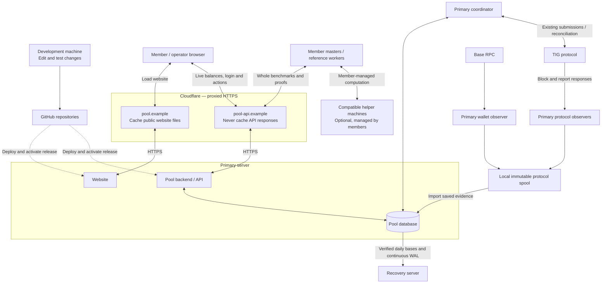

# Pool structure

Cloudflare proxies both addresses; the website and backend run on the same
primary server. Public HTTPS, browser access and the normal worker client all
pass connectivity checks once the [setup checklist](CLOUDFLARE_SETUP.md) is
complete.

- **Two addresses, one primary server.** Both DNS records use **Proxied**
  (orange cloud), with HTTPS on both connections. The zone uses
  **Full (strict)**. A verified Cloudflare Origin CA certificate
  protects the Cloudflare-to-origin connection. Browser requests and normal
  worker API requests work. The scoped Browser Integrity Check exception
  applies only to `/api/v2/` on the API hostname.
- **Cache public website files; keep live data uncached.** The browser loads
  the website from `pool.example`, then calls
  `pool-api.example/api/v2` for login, balances and actions. Workers use
  that same API address for their work. Member and operator permissions remain
  distinct from worker permissions. API traffic must not receive browser
  challenge pages.
- **Updates become live after deployment and activation.** Saving changes to
  GitHub alone doesn't update the website. Public CSS/JavaScript use
  content-hashed URLs and can be cached for a year; HTML and all API responses
  use `no-store`. Deployment retains older public asset hashes so pages already
  open can finish loading. Public checks verify cached assets and uncached
  HTML/API responses.
- **The coordinator and observers talk directly to TIG and Base.** Outgoing protocol connections and
  backup transfers do not pass through the website's Cloudflare proxy.
- **Members coordinate their own compute.** A member's master may use local
  cores and compatible helper machines while presenting one complete benchmark
  to the pool. Members manage the helper connections shown above. The installed
  reference worker uses local concurrency; it includes no helper transport.
  See the [member master contract](MEMBER_MASTER_V2.md).
- **Backup takeover is manual.** The recovery server preserves recovery data
  until needed. Recovery includes switching Cloudflare's origin to the backup
  after stopping the old primary and verifying the restored pool.
- **Recovery receives database backups, WAL, encrypted settings and
  pending-file snapshots.** Its independent TIG collectors are inactive, and
  the raw copy of the primary's evidence spool is an optional feature that is
  disabled by default; both are operator decisions listed in
  [the roadmap](ROADMAP.md). Pending raw files are outside database protection
  until imported; the pending-file snapshot covers them. See
  [the storage map](STORAGE_MAP.md).

The existing API version remains `/api/v2`; the hostname split does not require
renaming it to `/api/v1` or creating a second backend.

The diagram shows pool connections and the optional member-managed helper
arrangement. It does not establish validated multi-machine execution or a completed
mainnet reward cycle. See [the roadmap](ROADMAP.md) for what has and has not
been validated.

To preview this Markdown file in VS Code, press **Ctrl+Shift+V**
(**Cmd+Shift+V** on Mac). To open the preview beside the source, press
**Ctrl+K**, then **V** (**Cmd+K**, then **V** on Mac).
