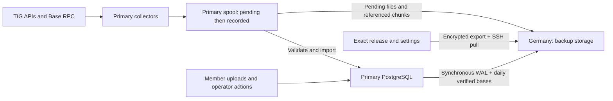

# Pool data and its path to recovery

Checked against the **14 October 2026** deployment: pool `59a3446`, worker
`dddad9d`, migrations through 022. Primary is Helsinki `46.62.249.188`;
recovery is Nuremberg `2.28.230.81`. The ordering conflict is resolved and all
26,050 historical observed blocks have compact replacements. See
[the storage fix](STORAGE_ORDERING_FIX_20261014.md) for recovery verification,
cleanup counts and measurements. The previous full-network storage survey is
preserved as [the historical 9 October trace](STORAGE_MAP_20261009.md).

## Data sources and contents

| Data | Source | What the pool retains |
|---|---|---|
| Member access | Wallet login and execution-token issuance | Member identity, destinations, settings/revisions, used/expired login challenges and execution-token hashes/revocation. |
| Money and obligations | Pool transactions and verified Base/TIG facts | `accounts`, append-only `journals`/`entries`, deposits, withdrawals, collateral holds/outcomes, fee funding and reconciliation. These establish ownership of the shared wallet's funds. |
| Work ownership and submissions | Member requests/uploads, coordinator and confirmed TIG responses | Reservations, exact assignment/digest, owner, acknowledgment, results, sampled nonces/proofs, protocol send intents/timestamps and outcome evidence. |
| Algorithm downloads | Checked public TIG/GitHub archive | URL, SHA-256 and byte count in `reservation_binaries`. Members fetch and verify the public archive directly. The compatibility store/endpoint remains for old assignments. |
| Block observations | TIG block, challenge, algorithm, opow and benchmark APIs | Compact pool feed, original block/config headers, qualifier totals, best selection references, source hashes and bounded request provenance. Other members' full feeds are discarded before spool/database writes. |
| Reports and arbitration | TIG confirmation headers and selective reporting/report APIs | Positive reporting membership, scoped final reports/arbitrations for pool obligations, their source hashes, parsed facts, associations and seals. Final collection waits until X+2 and the applicable reporting window close. |
| Wallet and submission-credit evidence | Read-only Base RPC and TIG player-data API | Chain anchors, finalized transfers, receipts/balance observations, fee balance and top-up facts, cursors and failure diagnostics. |
| Credit and settlement | Calculations over validated observations | Per-block pool/member credit, coverage/reconciliation, collateral finalization, earnings/receipts/reimbursements and round allocations. Financial, ownership and derived credit records are permanent. |
| Operational controls | Operator and maintenance jobs | Recorded pause, limits/revisions, migration checksums, retention floors/runs, alerts and immutable conflict resolutions. |
| Member machine evidence | Member's worker | Worker SQLite state and nonce/result/proof files stay on that member's machine. Pool server backups do not copy those files. |

The block collector still **reads and validates the whole current network**
to calculate credit and selection references. Its saved observation is the
compact `pool-network-v1` projection. New failed captures retain a header and
bounded diagnostic; they do not supply valid financial evidence.

Reporting follows open collateral/reward obligations. Empty index responses
are not archived; positive membership and unchanged responses are deduplicated.
Final evidence keeps relevant pool facts. Incomplete responses, open windows
and pending arbitration cause retries. Collection itself does not move money.
See [lean storage](LEAN_STORAGE.md) for the precise format and reporting gates.

## What happens to a captured response

Collectors save compressed, checksummed files **before database import**.
Publication is atomic and flushed to disk. A recorder imports each observation
and moves its manifest from `pending/` to `recorded/`. Repeated content uses
SHA-256 addressed chunks; compact blocks use one compressed blob.

`recorded` means the recorder processed a file. A failed capture can be recorded
without valid financial evidence, and some failed report files have no database
capture row. Those files cannot be removed merely because they are recorded.
Successful imported spool copies are redundant once the matching database
record is backed. Guarded pruning checks the original identity or report
payload/scope, backup cutoff and applicable obligations. Pending files are
protected; future, failed and unmatched files are preserved when they lack the
required backup/identity proof. Writing pins protect unpublished chunks while
maintenance runs.

Balances change through journal entries. Locks, unique identities, append-only
records and checksums prevent duplicate sends, ownership changes or repeated
credit. A compact replacement does not change an observed block's original
identity, credit or reconciliation.

## Exactly how Germany receives the data

### Continuous WAL

WAL is PostgreSQL's **write-ahead log**, the ordered changes needed to advance
a database backup. Germany's `pg_receivewal` stores this stream through a
restricted SSH tunnel using a replication-only database role and pinned host
keys. The receiver saves files; it does not run an active replacement pool.

Normal runtime and migration-owner transactions require the receiver's disk
acknowledgment. All six primary application services use the runtime role with
synchronous commits. The separately configured observer role uses local
commits and is not the role those services use. File capture can continue
while database import waits for the receiver.

WAL protects imported database data. Files awaiting import, application/settings
files and member machine files are outside that stream.

### Daily database bases

Recovery takes a physical database base daily. A new base is published only
after archive checksums, PostgreSQL data checksums and required WAL parsing
pass. Retention keeps **three verified bases plus the WAL required since the
oldest base**. Removing an old base does not permit deleting WAL needed by a
base that remains.

An actual isolated restore on 14 October replayed 229 later WAL segments from
the 03:13 UTC base to the sealed conversion boundary. All 26,050 compact copies
and 47 protected table fingerprints matched, including accounting, ownership,
the original conflict alert and its resolution. The disposable database was
removed after verification. See [the detailed record](STORAGE_ORDERING_FIX_20261014.md).

### Pending protocol files

Recovery copies bounded snapshots of **pending** block, report, custody and
funding manifests, plus only their referenced content. The job runs again one
minute after completion; health requires the protected source snapshot to be
no more than five minutes old. It verifies file/content hashes, cluster identity
and a source WAL boundary durably acknowledged on Germany before publication.
Two verified generations are retained. The copy never deletes primary files.

This covers the interval before a capture enters PostgreSQL. There is no full
recorded-spool mirror. Independent recovery collectors remain inactive.
See [pending evidence protection](PENDING_EVIDENCE_BACKUP.md).

### Release and settings

The daily export includes the pinned pool source archive, service units and
encrypted settings, credentials and TLS configuration. Recovery pulls these
exports over restricted SSH every five minutes. Off-host file hashes and
private decryption were verified on 14 October. Configuration export does not
advance the database recovery point; WAL and bases provide that protection.

## Paths

| Host | Location | Content |
|---|---|---|
| Primary | Docker `innopool-v2-mainnet-db`, database `innopool_v2_mainnet`, schema `pool_v2` | Ledger, ownership, captures, credit, settlement and controls |
| Primary | `/var/lib/innopool-v2-mainnet/spool/{blocks,reports,custody,funding}/` | `pending/`, `recorded/`, `chunks/` and writing pins |
| Primary | `/opt/innopool-v2-mainnet/` | Pinned releases, worker releases, artifacts and operation scripts |
| Primary | `/etc/innopool-v2-mainnet/` | Protected runtime/deployment settings and credentials |
| Primary | `/var/lib/innopool-v2-mainnet-backups/` | Encrypted exports and checked release/configuration manifests |
| Recovery | `/var/lib/innopool-v2-mainnet/primary-continuous/` | Verified database bases, WAL and protection records |
| Recovery | `/var/lib/innopool-v2-mainnet/primary-base-archives/` | Two older verified bases on existing root disk; newest stays on the volume |
| Recovery | `/var/lib/innopool-v2-mainnet/primary-pending-evidence/` | Two verified pending-file snapshots |
| Recovery | `/var/lib/innopool-v2-mainnet/primary-backups/` | Pulled release and encrypted configuration exports |

The newest database base, continuous WAL and pending snapshots use persistent
guarded bind mounts on the **200 GiB EXT4 volume 107125099** at
`/mnt/HC_Volume_107125099`. Mount checks prevent silently writing those archives
to the root filesystem if the volume is unavailable. See
[the volume record](RECOVERY_VOLUME_20261013.md). Two older retained bases use
the server's spare root disk, with a combined catalogue and reserve checks for
both filesystems. The policy still keeps three bases and all WAL required by
the oldest. See [current base placement](BACKUP_BASE_ARCHIVES_20261014.md).

## Retention and cleanup

Compact block/report payloads follow the four-round policy, with obligations,
credit coverage, references and verified-backup guards. Wallet/fee database
captures follow the thirty-day policy. Capture identities/tombstones and
financial/credit/settlement records remain. Coverage gaps can hold an evidence
floor; the cap does not justify discarding uncredited evidence.

Redundant full-network originals can expire earlier after their validated
compact replacement, credit/reconciliation and any conflict resolution are
verified off-host. That is the 14 October historical cleanup. File chunk
collection honors surviving references and writing pins; database chunk
collection checks all current surviving captures under the writer lock.

Expiry makes PostgreSQL space reusable after vacuum. Allocated database files
and retained physical backups do not immediately shrink to logical payload
size. Current measurements belong in [operations status](OPERATIONS_STATUS.md)
and [the storage fix record](STORAGE_ORDERING_FIX_20261014.md), rather than
being treated as fixed capacity requirements.

## Current verification and holds

The ordering conflict at 1382587 has an immutable, fully replayed resolution.
Historical gaps **1375817** and **1376650** remain unresolved; the earlier
prelaunch waiver at 1372249 is unchanged. A backup cannot recreate a block
that was never captured. These gaps continue to hold exact settlement.
New work is durably paused and settlement disabled. The successful two-server
CPU activation is recorded separately from still-unverified reward settlement.
